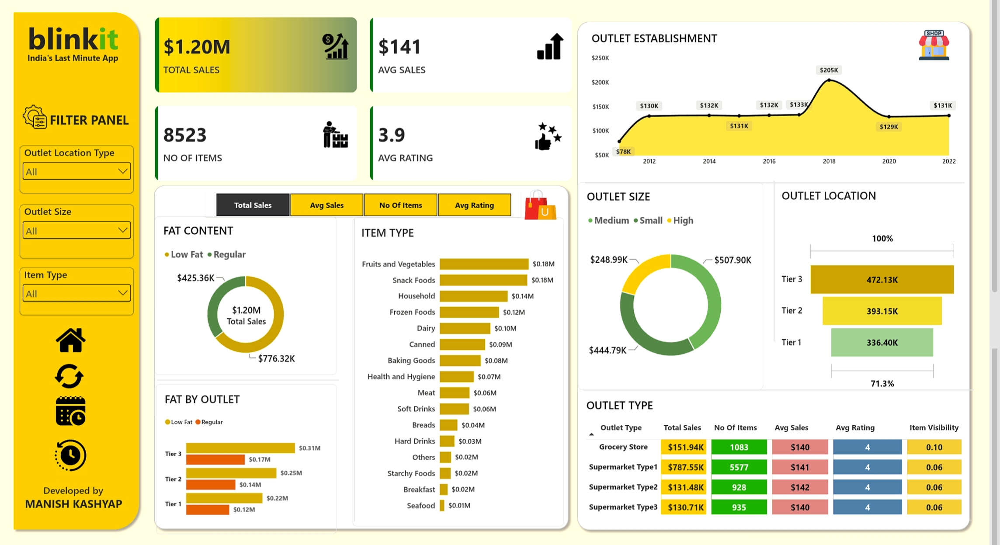

🛡️ Prism Insurance Analysis Dashboard | SQL Server & Power BI

  

<h1 align="center">📊 Prism Insurance Analysis Dashboard</h1>

  <b>Transforming Insurance Data into Actionable Business Insights 🚀</b>

  
  
  
  

  
  

---

📌 Project Overview

Prism Insurance Analysis is a data analytics project developed as part of my learning journey through the Complete Data Analyst Bootcamp: From Basic to Advanced on Udemy.

The project focuses on analyzing insurance data to understand premium performance, policy coverage, claim amounts, claim status, and customer demographics.

Using Microsoft SQL Server for data retrieval and Microsoft Power BI for interactive reporting, this project transforms raw data into meaningful business insights and actionable recommendations.

The dashboard helps explore insurance performance, identify claim management opportunities, and support data-driven decision-making.

---

🎯 Project Objectives

The main objectives of this project are to:

- 💰 Analyze total premium and total coverage.
- 📋 Evaluate total claim amounts and claim status distribution.
- 🛡️ Compare insurance performance across different policy types.
- 👥 Analyze customer demographics by age and gender.
- 🔎 Identify missing values and data quality issues.
- 📊 Develop meaningful KPIs for insurance performance monitoring.
- 💡 Generate actionable business recommendations.
- 🗄️ Retrieve and explore insurance data using Microsoft SQL Server.

---

📁 Dataset Information

Attribute| Details
📊 Dataset| Prism Insurance Data
🗄️ Data Retrieval| Microsoft SQL Server
📈 Visualization Tool| Microsoft Power BI
💻 Query Language| SQL
🔄 Transformation| Power Query
📐 Calculations| DAX
🏢 Domain| Insurance Analytics
🎯 Analysis Type| Exploratory & Business Analysis

---

🖥️ Dashboard Preview

  

  <i>📊 Prism Insurance — Interactive Business Intelligence Dashboard</i>

«📸 Dashboard screenshot: Upload your actual Power BI dashboard screenshot to the repository root as "Final_Dashboard.jpg", or change the image path above to match your screenshot's filename.»

---

📊 KPI Framework

The dashboard summarizes key insurance metrics to provide a quick overview of business performance.

KPI| Dashboard Value| Business Purpose
💰 Total Premium| 5.98M| Understand premium volume
🛡️ Total Coverage| 600.55M| Evaluate total policy coverage
📋 Total Claim Amount| 16.91M| Monitor claim amounts

  
  
  

Note: Values are in the dataset's source units. The currency was not explicitly specified.

---

🔍 Business Analysis

1️⃣ Insurance Premium Analysis

Business Question: Which insurance policy types contribute the most to total premium?

Analysis Areas:

- Compare premiums across Travel, Health, Auto, Life, and Home insurance.
- Identify policy types with higher premium contributions.
- Understand how premium volume is distributed across the insurance portfolio.

Premium by Policy Type:

Policy Type| Total Premium
✈️ Travel| 2.48M
🏥 Health| 1.20M
🚗 Auto| 0.96M
❤️ Life| 0.73M
🏠 Home| 0.60M

Key Observation: Travel insurance contributed the highest premium among the policy types analyzed.

Follow-up Question: How do claim amounts and claim outcomes compare across these policy types?

---

2️⃣ Claim Status Analysis

Business Question: How are claims distributed across different processing outcomes?

Claim Status Distribution:

Claim Status| Number of Records
✅ Settled| 3,386
⏳ Pending| 2,263
❌ Rejected| 4,355

Analysis Areas:

- Compare settled, pending, and rejected claim records.
- Identify opportunities to improve pending-claim monitoring.
- Investigate rejection reasons where supporting data is available.
- Review missing claim dates and zero claim amounts before drawing conclusions.

Key Observation: Rejected claims represent a substantial share of the recorded claim statuses, making rejection-reason analysis an important follow-up opportunity.

«A rejection count alone does not explain why claims were rejected. Additional reason codes or claim-level details would be needed to investigate the causes.»

---

3️⃣ Claim Amount Analysis

Business Question: What is the total claim amount represented in the dataset?

Metric| Value
Total Claim Amount| 16.91M
Settled Claim Amount| 10.11M
Pending Claim Amount| 6.81M
Rejected Claim Amount| 0

Interpretation: Settled and pending records account for the recorded claim amounts in this dataset. Rejected records have zero claim amounts, so these values should be interpreted in the context of the source data and its claim-recording rules.

Further Analysis:

- Compare claim amounts across policy types.
- Analyze pending claim ageing.
- Investigate claim outcomes over time.
- Validate claim amount and claim date completeness.

---

4️⃣ Customer Demographic Analysis

Business Question: How is the insurance customer base distributed across age groups and gender?

Analysis Areas:

- Customer distribution by gender.
- Claim amounts by age group.
- Comparison of younger, adult, and older customer groups.
- Identification of demographic patterns that may warrant further investigation.

Claim Amount by Age Group:

Age Group| Claim Amount
Young Adults (≤30)| 3.04M
Adults (31–60)| 7.48M
Older Adults (>60)| 6.39M

Key Observation: Adults aged 31–60 account for the largest claim amount among these age groups in the dataset.

These are descriptive findings, not evidence that age or gender causes differences in claim amounts.

---

🧠 SQL Server Analysis

Microsoft SQL Server was used to retrieve and explore the insurance dataset before visualization and reporting.

🔹 SQL Skills Applied

- Data retrieval using "SELECT".
- Filtering records using "WHERE".
- Aggregating values using "SUM()" and "COUNT()".
- Grouping data using "GROUP BY".
- Comparing policy types and claim statuses.
- Exploring data quality and missing values.

🔹 Example SQL Query

SELECT
    PolicyType,
    SUM(PremiumAmount) AS TotalPremium,
    SUM(CoverageAmount) AS TotalCoverage,
    SUM(ClaimAmount) AS TotalClaimAmount
FROM InsuranceData
GROUP BY PolicyType
ORDER BY TotalPremium DESC;

Note: This is an illustrative query. Replace table and column names with the exact names in your SQL Server database.

🔹 Claim Status Summary Example

SELECT
    ClaimStatus,
    COUNT(*) AS TotalRecords,
    SUM(ClaimAmount) AS TotalClaimAmount
FROM InsuranceData
GROUP BY ClaimStatus
ORDER BY TotalRecords DESC;

---

🛠️ Tools & Technologies

Technology| Purpose
🗄️ Microsoft SQL Server| Data retrieval and SQL queries
📊 Microsoft Power BI| Interactive dashboard development
🔄 Power Query| Data transformation and preparation
📐 DAX| KPI development and analytical calculations
📈 Data Visualization| Presenting patterns and business metrics
💡 Business Analysis| Interpreting findings and recommendations

---

📈 Analysis Areas

Area| Analysis
💰 Premium| Total premium and policy type comparison
🛡️ Coverage| Total insurance coverage
📋 Claims| Total claim amounts
⏳ Claim Status| Settled, pending, and rejected records
👥 Demographics| Customer age and gender
🧹 Data Quality| Missing dates and zero claim amounts
📊 KPIs| Summary metrics for business monitoring
💡 Recommendations| Claim monitoring and reporting improvements

---

💡 Key Analytical Insights

- ✈️ Travel insurance recorded the highest total premium among the policy types analyzed.
- 📊 Claim status analysis highlights the need to monitor pending claims and investigate rejection reasons.
- 💰 Claim amount analysis helps distinguish settled and pending amounts in the available records.
- 👥 Customer segmentation provides a demographic view of recorded claim amounts.
- 🧹 Data quality checks help identify records that need validation before reporting.
- 🎯 KPI monitoring can help stakeholders track insurance performance more consistently.

---

🚀 Business Recommendations

1. ⏳ Improve Pending Claim Monitoring

Track how long claims remain pending and establish suitable processing targets.

2. 🔎 Investigate Claim Rejections

Capture rejection reason codes and review recurring issues to identify opportunities for process improvement.

3. ✈️ Monitor Policy Type Performance

Review premium contributions alongside claim amounts and claim outcomes rather than relying on premium totals alone.

4. 🧹 Strengthen Data Quality

Validate missing claim dates, zero claim amounts, duplicate records, and unique identifiers.

5. 📊 Expand the KPI Framework

Consider adding the following metrics:

- Claim Settlement Rate
- Claim Rejection Rate
- Pending Claim Count and Amount
- Pending Claim Ageing
- Average Claim Amount
- Premium-to-Claim Ratio

Each KPI should be defined clearly and calculated using the appropriate claim and policy grain.

---

🏗️ Dashboard Architecture & User Flow

Stage| Activity| Purpose
1️⃣| Data Retrieval| Access insurance data through SQL Server
2️⃣| Data Preparation| Check and transform data
3️⃣| KPI Development| Calculate key insurance metrics
4️⃣| Visualization| Present performance through Power BI
5️⃣| Business Analysis| Interpret patterns and claim outcomes
6️⃣| Recommendations| Suggest improvements based on findings

Analytical Workflow:

"SQL Server → Data Preparation → Power BI → KPI Analysis → Business Insights → Recommendations"

---

📂 Repository Structure

Prism-Insurance-Analysis-PowerBi/
│
├── README.md
├── ICONS/
│   └── prism_insurance_logo.png
├── InsuranceData.csv
├── Prism Insurance.pbix
└── Final_Dashboard.jpg

The structure above is a suggested layout. Keep only the files and folders that actually exist in your repository.

---

🚀 How to Explore the Project

1. Install Power BI Desktop on your computer.
2. Clone or download the repository from GitHub.
3. Open "Prism Insurance.pbix" in Power BI Desktop.
4. Explore the report pages, visualizations, and KPI cards.
5. Review the source data and analysis to understand the business findings.

For SQL analysis, use Microsoft SQL Server with the appropriate dataset and schema.

---

🎓 Learning Resource

  

Course: Complete Data Analyst Bootcamp: From Basic to Advanced
Platform: Udemy

This project was developed as part of my practical learning journey through the course, helping me apply data retrieval, analysis, visualization, and business reporting concepts.

---

🧠 Skills Demonstrated

- 🗄️ SQL Server Data Retrieval
- 💻 SQL Queries and Aggregations
- 📊 Power BI Dashboard Development
- 🔄 Power Query Data Transformation
- 📐 DAX and KPI Development
- 🧹 Data Quality Validation
- 📈 Exploratory Data Analysis
- 💡 Business Insights and Recommendations
- 🎯 Analytical Thinking and Data Storytelling

---

👨‍💻 About Me

Manish Kashyap
🎯 Aspiring Data Analyst
📊 SQL | Excel | Python | Power BI | Data Analytics
🤖 Artificial Intelligence & Machine Learning Enthusiast

I'm passionate about transforming raw data into meaningful insights and continuously building projects to strengthen my analytical and technical skills.

  
  

---

  ⭐ <b>If you find this project useful, consider giving the repository a star!</b>

  <b>Built with SQL Server, Power BI & a passion for Data Analytics 📊</b>

  <i>Turning Data into Insights. Turning Insights into Action. 🚀</i>

